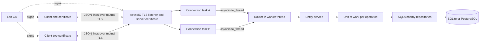

# Practice 3 architecture

The listener verifies each client during the TLS handshake before starting its
connection task. Each task reads and writes its own authenticated stream and
processes its requests sequentially. `drain()` waits for write capacity while
other tasks can continue. On end of stream, a socket error, or server shutdown,
the connection's writer is closed.

## Synchronous database access

A synchronous SQLAlchemy query called on the event-loop thread would stop
all clients from reading or writing until the query finished. The server
sends the whole router call to `asyncio.to_thread()`, so each operation opens,
uses, and closes its SQLAlchemy session in the same worker thread. The shared
engine manages its own connection pool. The router and service retain their
existing request validation, transactions, and CRUD behavior.

The worker pool and database pool limit how many operations can run at once.
SQLite still serializes writes, and a busy database can delay requests waiting
for a worker or connection. A database call already running can still finish
if its client disconnects or the connection task is cancelled. A missing
response leaves the client uncertain whether a write committed.
